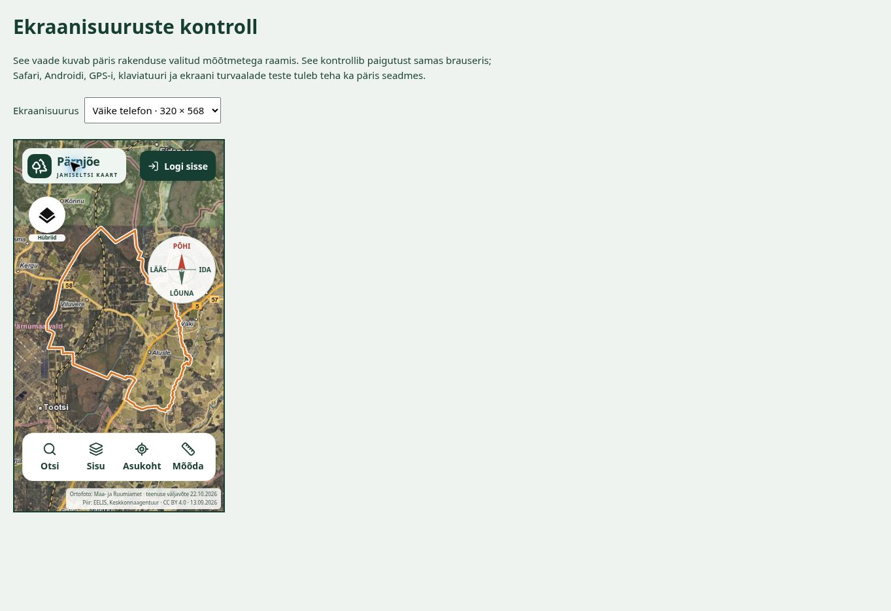
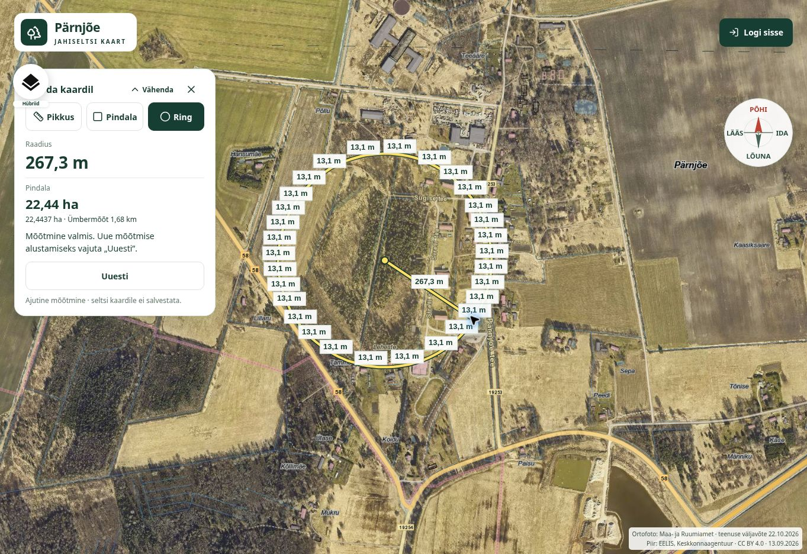
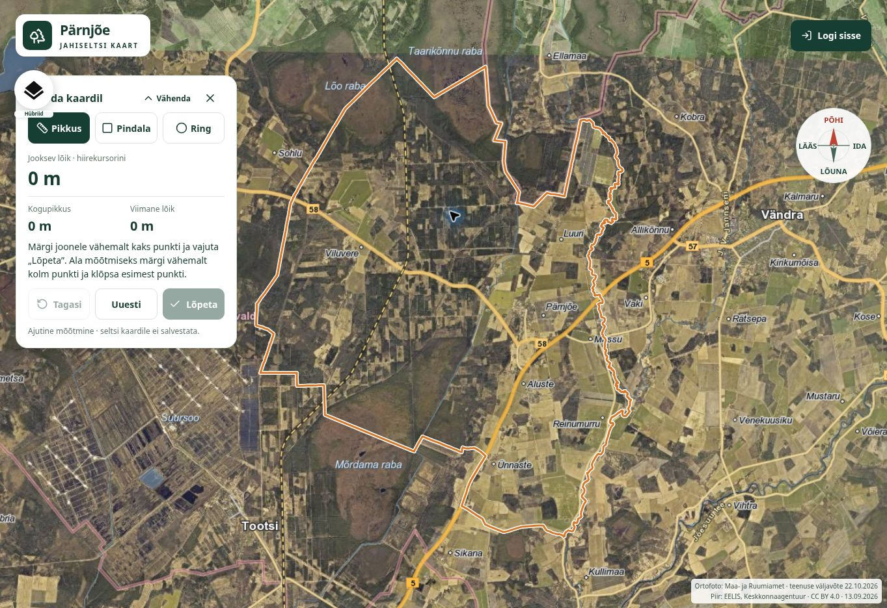

# Kolme testagendi brauseritest · 22.10.2026

Testiti avalikku lehte <https://soouni.github.io/jahiselts/> päris Chrome'i brauseris. Kõik kolm agenti kasutasid oma vahelehte. Mobiilimõõtude jaoks kasutati sama lehe [QA-vaate](https://soouni.github.io/jahiselts/qa/layout.html) fikseeritud iframe'e: 320 × 568, 390 × 844 ja 740 × 360. Arvutivaade oli 1363 × 936.

Need on brauseris korratud leiud, mitte üksnes lähtekoodist tehtud oletused. P2 tähistab funktsiooni või kasutusteed takistavat probleemi; P3 väiksemat loetavuse või paigutuse puudust. Tegu pole ametliku WCAG vastavusauditiga.

## Kinnitatud leiud

| ID | Tase | Puudus | Kordamine | Oodatud tulemus / soovitus |
| --- | --- | --- | --- | --- |
| QA-01 | P2 | Mobiilis ei avane jahipiirkonna infopaneel. | 320 × 568: vajuta Pärnjõe logo. Nupp muutub `aria-expanded=true`, kuid paneeli ei näe; brauseris on `.overview` stiil `display:none` ja mõõtmed 0 × 0. | Avatud infopaneel peab olema mobiilis nähtav ja keritav. |
| QA-02 | P2 | Ringmõõtmise tehniliste servade sildid katavad kaarti. | Mõõda → Ring → vali keskpunkt ja serv. Katses raadiusega 267,3 m ja pindalaga 22,44 ha tekkisid ringi ümber kümned „13,1 m“ sildid. | Ringi hulknurgalise lähenduse servi ei peaks eraldi märgistama; näidata kasutajale ringi raadiust/pindala ja soovi korral ümbermõõtu. |
| QA-03 | P2 | Otsingumodaali sulgemisel kaob klaviatuurifookus. | Liigu Tabiga Otsi-nupule, kontrolli aktiivset nuppu, ava Enteriga ja sulge Escape'iga. Pärast sulgemist on aktiivne element `BODY`, mitte Otsi. Korratud. | Taastada fookus modaali avanud nupule. |
| QA-04 | P2 | Kaardi panoraamimiseks ja suumimiseks ei leitud klaviatuuriteed. | Tab-järjekord läbib juhtnuppe, kuid jätab kaardi vahele. Brauseris puudub `.map` ja `.ol-viewport` elementidel `tabindex`; nähtavaid +/− suuminuppe pole. | Muuta kaart klaviatuuriga fokusseeritavaks ning pakkuda selgeid suumimisnuppe või juhiseid. |
| QA-05 | P3 | Aluskaardinupp katab arvutivaates mõõtmispaneeli pealkirja. | 1363 × 936: vajuta Mõõda. Nupp on ligikaudu x=22, y=108; paneel algab x=24, y=116 ning pealkirja vasak osa jääb nupu taha. Kaks agenti kinnitasid sama leiu. | Paigutada paneel ja aluskaardinupp mõõterežiimis kõrvuti või eri kõrgustele. |
| QA-06 | P3 | Aluskaardi silt on mobiilis liiga väike. | 320 × 568: „Hübriid“ tegelik kirjasuurus on 8 px ja sildi kõrgus umbes 10,8 px. | Suurendada loetavust, näiteks 11–12 px kirja ja vastavate vahedega, kontrollides uuesti kattumist. |

## Ekraanipildid

### Mobiili infopaneel ja väike aluskaardisilt

### Ringmõõtmise liigsed sildid

### Mõõtmispaneeli pealkirja kattumine

## Töötanud teekonnad

- Põhitoimingute agendil töötasid Pärnjõe kohanime otsing, tulemuse kuvamine ja peitmine, jahipiiri lülitamine ning kõik kolm aluskaarti.
- Mobiilis mahtusid alumise riba nupud vaatesse. „Sisu“ paneel oli 390 px vaates nähtav ja keritav, ilma horisontaalse ülevooluta.
- Mõõtmispaneeli sai avada, vähendada ja sulgeda; sulgemisel taastus tavapärane navigeerimine.
- Klaviatuurifookuse oranž piir oli nähtav; otsingudialoogil olid pealkiri ja nimega sulgemisnupp.
- Otsingu vastamata jätmisel kuvati ligipääsetav veateade ja „Proovi uuesti“ nupp.

## Piirangud ja eristatud juhtumid

- Mobiilimõõte kontrolliti päris brauseris iframe'idega, mitte iPhone'i Safaris või Androidi Chrome'is. Ekraaniklaviatuuri ja seadme turvaalade käitumist ei kinnitatud.
- Testiti külalisvaadet. Sisselogitud liikmevaateid, uut ilmavaadet, jahitoiminguid ega GPS-i ei kontrollitud.
- Ekraanilugerit ei kasutatud.
- Ühel agendil otsinguteenus testi ajal ei vastanud, teisel otsing töötas. Selle põhjuseks ei saa olemasoleva tõendi alusel nimetada rakenduse viga.
- Iframe'i suuruse muutmise järel nähtud esialgne kaardi tühimik kadus laadimise lõppedes; seda ei raporteeritud veana.
- Koodi, seltsi andmeid ega õigusi testimisel ei muudetud. Raport ei tähenda, et leiud oleks parandatud.

## Soovitatud parandamise järjekord

1. QA-01: mobiili infopaneeli avamine.
2. QA-02: ringmõõtmise liigsete siltide eemaldamine.
3. QA-03 ja QA-04: klaviatuuriga kasutamise parandamine.
4. QA-05 ja QA-06: kattumine ja väikeste siltide loetavus.
